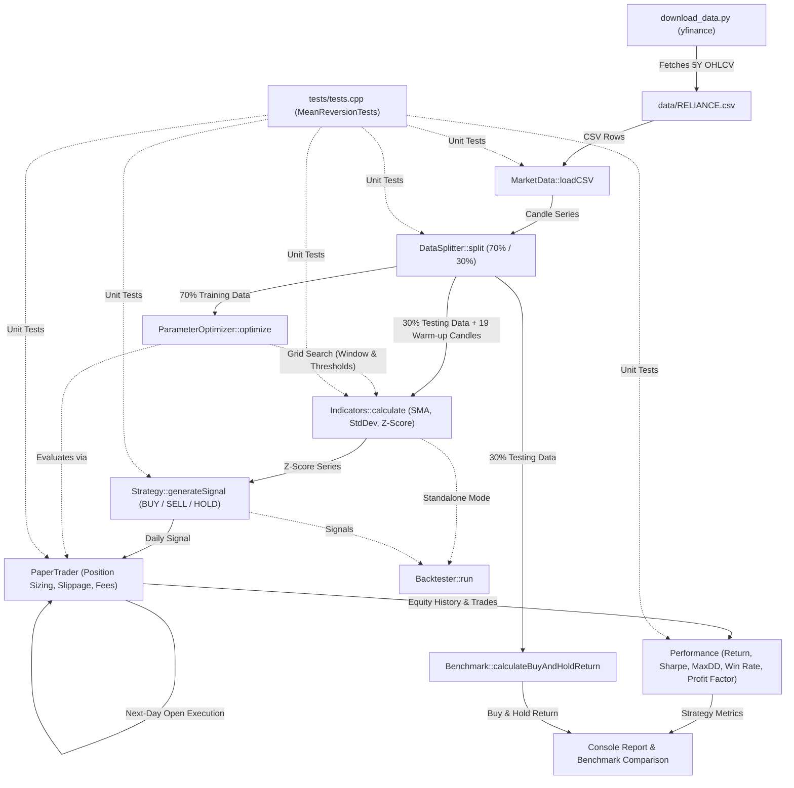

# C++ Mean Reversion Trading System

A C++17 quantitative trading system that implements a Z-score-based Mean Reversion strategy for historical stock market data.

## 1. Project Overview

This project implements a systematic trading strategy that identifies when a stock price moves significantly below its rolling average and generates trading signals based on statistical deviations.

The system includes:
- Historical market data processing
- Technical indicator calculation
- Mean Reversion signal generation
- Backtesting with transaction costs and slippage
- Portfolio management and position sizing
- Daily equity tracking
- Performance measurement
- Buy-and-Hold benchmark comparison
- Training and testing data separation
- Parameter optimization
- Unit tests

## 2. Strategy

The strategy uses:

- Simple Moving Average (SMA)
- Rolling Standard Deviation
- Z-score

**Z-score formula:**

Z = (Closing Price - SMA) / Standard Deviation

### Trading Rules

| Condition | Action |
|---|---|
| Z-score <= -2 and > -3 | BUY |
| Z-score >= 0 while holding | SELL |
| Z-score <= -3 while holding | Risk exit |
| Otherwise | HOLD |

The strategy is long-only.

## 3. Project Architecture

### System Architecture Diagram



### Directory Structure

```text
C++ Mean Revision Trading System/
│
├── .gitignore
├── CMakeLists.txt               # Builds MeanReversion & MeanReversionTests
├── download_data.py             # Downloads RELIANCE.NS historical data via yfinance
├── README.md
│
├── data/
│   └── RELIANCE.csv             # Historical OHLCV market data
│
├── include/
│   ├── Backtester.h             # Standalone trade-level backtester interface
│   ├── Benchmark.h              # Buy-and-Hold return calculator
│   ├── DataSplitter.h           # Train/test data splitter
│   ├── Indicators.h             # SMA, Standard Deviation, Z-Score
│   ├── MarketData.h             # Candle struct & CSV loader
│   ├── PaperTrader.h            # Portfolio, equity curve & trade execution
│   ├── ParameterOptimizer.h     # Grid search parameter optimizer
│   ├── Performance.h            # Return, Sharpe, drawdown, win rate & profit factor
│   └── Strategy.h               # Mean reversion signal generator
│
├── src/
│   ├── main.cpp                 # Entry point orchestrating the pipeline
│   ├── Backtester.cpp
│   ├── Benchmark.cpp
│   ├── DataSplitter.cpp
│   ├── Indicators.cpp
│   ├── MarketData.cpp
│   ├── PaperTrader.cpp
│   ├── ParameterOptimizer.cpp
│   ├── Performance.cpp
│   └── Strategy.cpp
│
└── tests/
    └── tests.cpp                # Unit tests for all core modules
```

## 4. Technologies Used

- C++17
- STL
- CMake
- CLion
- Historical stock market CSV data

## 5. Backtesting Assumptions

- Initial capital: ₹100,000
- Position allocation: 10% of available cash
- Transaction cost: 0.1% per transaction
- Slippage: 0.05%
- Long-only trading
- Signals generated using closing prices
- Orders executed at the following trading day's opening price

These are simulation assumptions, not actual broker charges or guaranteed execution conditions.

## 6. Data Evaluation

Historical data is divided into:

- 70% training data
- 30% testing data

Strategy parameters are selected using training data and then evaluated on the testing period.

## 7. Performance Metrics

The system calculates:

- Total portfolio return
- Annualized Sharpe ratio
- Maximum drawdown
- Win rate
- Total trades
- Profit factor
- Daily equity curve

The strategy is also compared against a Buy-and-Hold benchmark.

## 8. Backtest Results

Backtested on historical **RELIANCE.NS** daily stock data (`data/RELIANCE.csv`, 1,236 candles from 2021-11-26 to 2026-11-26, 70/30 split):
- **Training Period**: 865 candles
- **Testing Period**: 371 candles (2025-05-29 to 2026-11-26)
- **Initial Capital**: ₹100,000.00 | **Final Strategy Equity**: ₹100,570.92 | **Final Buy & Hold Equity**: ₹97,291.58

| Metric | Mean Reversion | Buy & Hold |
|---|---|---|
| Total Return | +0.5709% | -2.7084% |
| Sharpe Ratio (Annualized) | 0.3700 | 0.0237 |
| Maximum Drawdown | 0.9026% | 27.2750% |
| Win Rate | 57.14% (4W / 3L) | — |
| Total Trades | 7 | 1 |
| Profit Factor | 1.6607 | — |
| Excess Return vs Benchmark | +3.2793% | — |

## 9. Build Instructions

Requirements:
- C++17-compatible compiler
- CMake 3.20 or later

Build using:

```bash
cmake -S . -B build
cmake --build build
```

Run the executable from the project root so that the relative CSV path resolves correctly.

## 10. Future Improvements

- Live market data integration
- More advanced portfolio risk management
- Multi-stock portfolio backtesting
- Walk-forward validation
- Improved parameter optimization
- Broker-connected paper trading

## 11. Disclaimer

This project is intended for educational and research purposes. Backtested performance does not guarantee future results.
